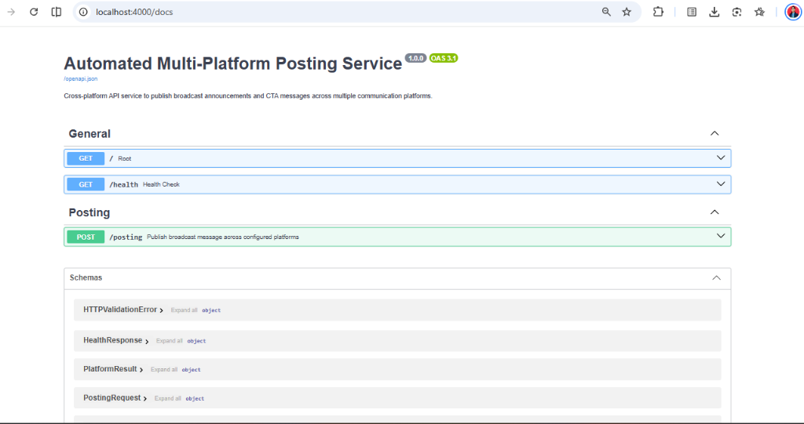
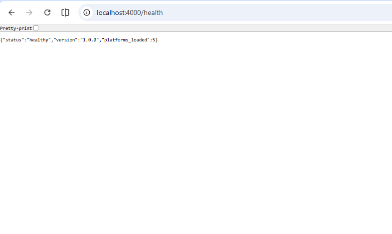

# Automated Multi-Platform Posting Service

A modular, asynchronous FastAPI service designed to broadcast short updates and call-to-action (CTA) announcements across multiple communication channels and publishing platforms in parallel.

The system natively supports **Telegram**, **Discord**, **Slack**, **Mastodon**, and **Dev.to**. It guarantees failure isolation: if one platform encounters network latency, rate limits, or authentication errors, the remaining platforms continue processing uninterrupted.

---

## Features

- **Concurrent Multi-Platform Dispatch**: Uses `asyncio.gather` and `httpx.AsyncClient` with connection pooling to distribute posts concurrently.
- **Strict Input Validation**:
  - Message length capped at 200 characters.
  - Enforces exactly one valid CTA link (HTTP/HTTPS) per post.
  - Automatically cleans trailing sentence punctuation attached to URLs.
- **Resilient Execution**: Platform errors are isolated per service. Each channel returns an explicit status, timestamp, published URL, public access flag, or detailed error reason.
- **Zero-Dependency Simulation Mode**: Includes an optional simulation toggle (`SIMULATION_MODE=true`) for local testing and CI/CD pipelines without requiring live third-party API credentials.
- **Interactive Documentation**: Auto-generated OpenAPI / Swagger UI at `/docs` and ReDoc at `/redoc`.

---

## Project Structure

```
automated-posting/
│
├── app/
│   ├── __init__.py
│   ├── main.py                  # FastAPI application entrypoint and route handlers
│   ├── config.py                # Environment and settings configuration (pydantic-settings)
│   ├── schemas.py               # Pydantic models for validation and responses
│   │
│   ├── platforms/               # Platform-specific publishing adapters
│   │   ├── __init__.py
│   │   ├── base.py              # Base abstract adapter class
│   │   ├── telegram.py          # Telegram Bot API integration
│   │   ├── discord.py           # Discord Webhook API integration
│   │   ├── slack.py             # Slack Incoming Webhook integration
│   │   ├── mastodon.py          # Mastodon REST API integration
│   │   └── devto.py             # Dev.to / Forem API integration
│   │
│   └── services/
│       ├── __init__.py
│       └── posting_service.py   # Asynchronous broadcast orchestrator
│
├── tests/
│   ├── __init__.py
│   ├── conftest.py              # Pytest fixtures and test clients
│   └── test_posting.py          # Validation, execution, and resilience unit tests
│
├── .env.example                 # Example environment variables
├── .gitignore                   # Standard Python gitignore rules
├── pytest.ini                   # Pytest runtime configuration
├── requirements.txt             # Project dependencies
└── README.md                    # Project documentation
```

---

## Getting Started

### 1. Prerequisites

- Python 3.10+
- `pip` or virtual environment manager

### 2. Installation

Clone the repository and install required dependencies:

```bash
git clone <repository-url>
cd automated-posting

# Create and activate virtual environment
python -m venv venv
# On Windows:
venv\Scripts\activate
# On Linux/macOS:
source venv/bin/activate

# Install dependencies
pip install -r requirements.txt
```

### 3. Environment Configuration

Copy the sample environment file:

```bash
cp .env.example .env
```

Edit `.env` to configure desired platform credentials:

```ini
APP_HOST=0.0.0.0
APP_PORT=4000
REQUEST_TIMEOUT_SECONDS=10.0

# Set to true to test the workflow without active API tokens
SIMULATION_MODE=false

# Telegram Bot API
TELEGRAM_BOT_TOKEN=
TELEGRAM_CHAT_ID=
TELEGRAM_CHANNEL_USERNAME=

# Discord Webhook
DISCORD_WEBHOOK_URL=

# Slack Incoming Webhook
SLACK_WEBHOOK_URL=

# Mastodon API
MASTODON_INSTANCE_URL=https://mastodon.social
MASTODON_ACCESS_TOKEN=

# Dev.to API
DEVTO_API_KEY=
```

### 4. Running the Server

Start the application with Uvicorn:

```bash
uvicorn app.main:app --host 0.0.0.0 --port 4000
```

The service will be accessible at:
- **API Base:** `http://localhost:4000`
- **Swagger Documentation:** `http://localhost:4000/docs`
- **Health Check:** `http://localhost:4000/health`

---

## API Documentation

### `POST /posting`

Broadcasts a message to all integrated platforms.

#### Request Headers
`Content-Type: application/json`

#### Request Body
```json
{
  "message": "Check out our latest business platform and grow your online visibility. https://example.com"
}
```

#### Validation Rules
| Rule | Condition | Failure Response |
| :--- | :--- | :--- |
| **Max Length** | `<= 200` characters | `422 Unprocessable Content` |
| **CTA Link** | Exactly 1 valid URL | `422 Unprocessable Content` |
| **URL Scheme** | `http` or `https` | `422 Unprocessable Content` |

#### Successful Response (`200 OK`)
```json
{
  "success": true,
  "results": [
    {
      "platform": "Telegram",
      "status": "success",
      "posted_url": "https://t.me/broadcast_feed/1042",
      "public_access": true,
      "date": "2026-11-21",
      "time": "18:30:00",
      "error": null
    },
    {
      "platform": "Discord",
      "status": "success",
      "posted_url": "https://discord.com/channels/1122334455/6677889900/1234567890123456",
      "public_access": true,
      "date": "2026-11-21",
      "time": "18:30:00",
      "error": null
    },
    {
      "platform": "Slack",
      "status": "success",
      "posted_url": "https://app.slack.com/client/T012345678/C012345678",
      "public_access": false,
      "date": "2026-11-21",
      "time": "18:30:00",
      "error": null
    },
    {
      "platform": "Mastodon",
      "status": "success",
      "posted_url": "https://mastodon.social/@broadcaster/1119827364510",
      "public_access": true,
      "date": "2026-11-21",
      "time": "18:30:00",
      "error": null
    },
    {
      "platform": "Dev.to",
      "status": "success",
      "posted_url": "https://dev.to/community/announcement-update-29384",
      "public_access": true,
      "date": "2026-11-21",
      "time": "18:30:00",
      "error": null
    }
  ]
}
```

#### Partial / Unconfigured Response (`200 OK`)
If certain platform credentials are missing or encounter network issues, the service returns descriptive failures for those specific targets while preserving successes on others:

```json
{
  "success": false,
  "results": [
    {
      "platform": "Telegram",
      "status": "failed",
      "posted_url": null,
      "public_access": false,
      "date": null,
      "time": null,
      "error": "TELEGRAM_BOT_TOKEN or TELEGRAM_CHAT_ID not configured."
    },
    {
      "platform": "Discord",
      "status": "failed",
      "posted_url": null,
      "public_access": false,
      "date": null,
      "time": null,
      "error": "DISCORD_WEBHOOK_URL not configured."
    }
  ]
}
```

---

## cURL Examples

**Valid Broadcast Request:**
```bash
curl -X POST "http://localhost:4000/posting" \
     -H "Content-Type: application/json" \
     -d '{"message": "Check out our latest business platform and grow your online visibility. https://example.com"}'
```

**Testing Validation (Missing CTA Link):**
```bash
curl -X POST "http://localhost:4000/posting" \
     -H "Content-Type: application/json" \
     -d '{"message": "Announcement message without any link"}'
```

---

## Running Automated Tests

The test suite covers:
- Input validation (length constraints, single CTA link enforcement, protocol checking, whitespace, edge cases).
- Execution output schema compliance.
- Platform resilience (verifying that platform failures do not block other integrations).
- Health check and root endpoints.

Execute tests using `pytest`:

```bash
pytest tests/ -v
```

---

## Screenshots & Verification

### Interactive API Documentation (`/docs`)


### Service Health Check (`/health`)


---

## Supported Platform Integrations

1. **Telegram**:
   - Uses Telegram Bot API `POST /sendMessage`.
   - Produces canonical message permalinks (`https://t.me/<channel>/<message_id>`).
2. **Discord**:
   - Uses Discord Webhooks with `?wait=true`.
   - Captures message IDs to generate server channel permalinks.
3. **Slack**:
   - Uses Slack Incoming Webhooks.
   - Posts directly to private or public workspace channels.
4. **Mastodon**:
   - Uses Mastodon REST API `POST /api/v1/statuses`.
   - Publishes public federated statuses with public web URLs.
5. **Dev.to**:
   - Uses Dev.to / Forem API `POST /api/articles`.
   - Formats announcements into markdown articles with linked CTAs.
